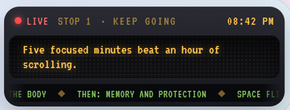
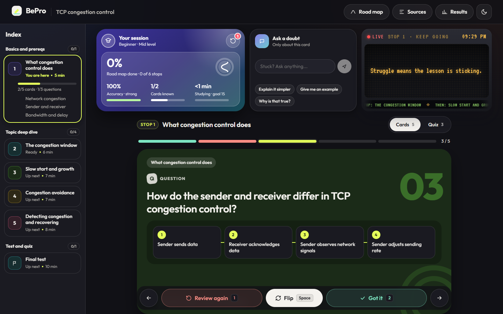
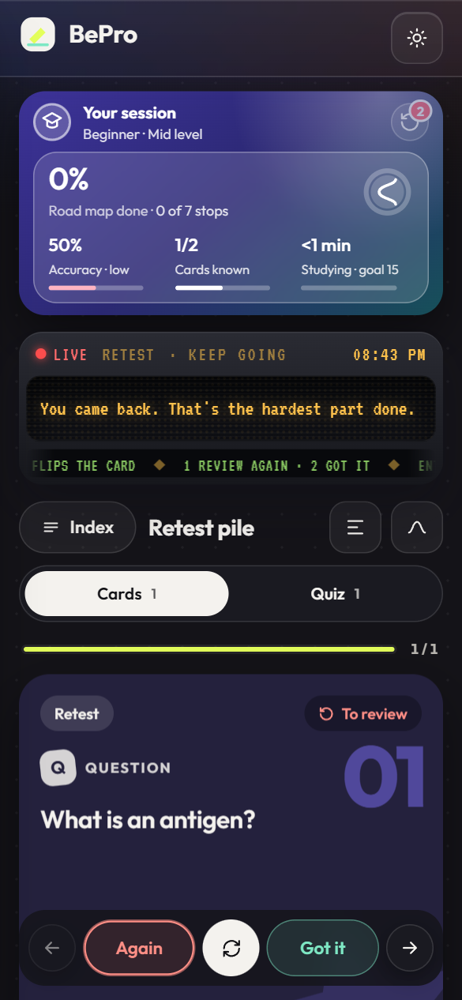
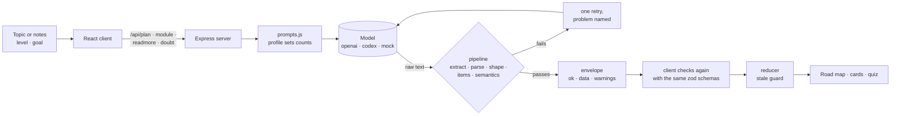
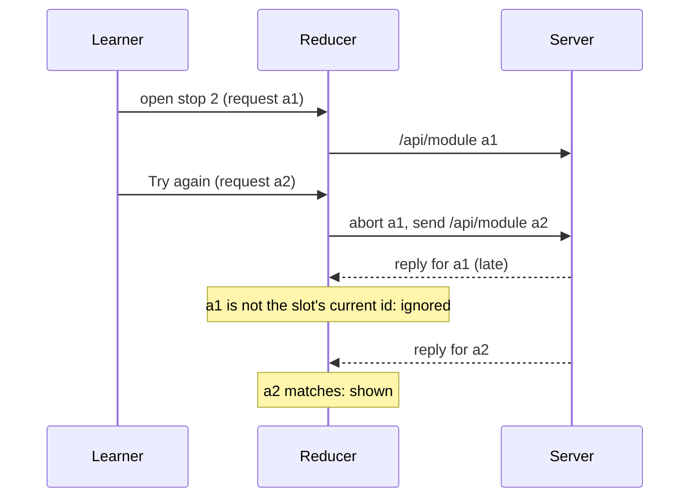

<div align="center">

<a href="#try-it-in-a-minute"></a>

### Type a topic. Get a road map of flashcards to flip, not a chat to scroll.


<p>
<a href="https://youtu.be/6PnWsOYxUWE"></a>
<a href="#try-it-in-a-minute"></a>
<a href="SPEC.md"></a>
</p>

<p>
<a href="#the-story-in-60-seconds">The story in 60 seconds</a> ·
<a href="#every-feature">Every feature</a> ·
<a href="#how-bad-model-output-is-handled">Bad AI output</a> ·
<a href="#the-evidence-against-each-grading-area">Grading areas</a> ·
<a href="#try-it-in-a-minute">Run it</a> ·
<a href="#how-i-built-it">How I built it</a>
</p>

</div>

## What is BePro?

**BePro is an AI study assistant that turns a topic, or your own notes, into a road map you study flashcard first.**

You type what you want to learn and pick two things: who you are (*Beginner*, *Intermediate*, *Pro*) and what you want (*Master*, *Mid level*, *Crash course*). BePro builds a road map of stops. At each stop you flip cards, rate them, then take a short quiz. Everything you missed goes to a **retest pile**, and the results page shows your weak spots.

The model never writes the screen. **Our code decides the structure** (how many stops, cards and questions, how long an answer may be), the model fills in the content as JSON, and **every reply is checked** before it reaches you.

> **The model proposes the content. The code decides what reaches the screen.**

## The story in 60 seconds

1. **Ask.** "How vaccines work", Beginner, Mid level. The level sets the depth, the goal sets the breadth: Mid level means 5 stops of 5 cards and 3 questions, plus a final test ([`shared/profile.js`](shared/profile.js)).
2. **See the plan.** A road map of stops in phases. Rename, move, delete or add a stop, or type "add a stop on herd immunity" in **Adjust plan**: the model edits the plan you have instead of starting over.
3. **Flip.** Each card has a question and, often, a chart, flow, diagram, animation or picture. Space flips it; **1** sends it to the retest pile, **2** marks it known. **Read further** opens a longer explanation inside the card.
4. **Get stuck?** **Ask a doubt** answers only about the card on screen, and never gives away an unanswered quiz question.
5. **Stay on track.** The **live board**, styled like a railway departures display, rotates study tips by itself, scrolls your next stops and the shortcuts, and after two **Review again** in a row it swaps in a hint.
6. **Take the quiz.** Wrong answers join the retest pile. Options are shuffled, because models like to put the right answer first.
7. **See your results.** A score per stop, weak spots marked, and **Retest the N I missed**. Close the tab and come back: the session reloads.

And when the model gets it wrong, you see a plain message and **Try again**, never a blank page. [How that works](#how-bad-model-output-is-handled).

## Tour the product

These captures come from a real model run (local Codex) on 15 November 2026, on the current layout.

<p align="center"></p>

<p align="center"><b>The live board.</b> A study screen that feels alive, like a departures board: the line changes every few seconds, the next stops scroll past, and it reacts when you struggle.</p>

| Plan and learn | Check and review |
| --- | --- |
| **Start.** Type a topic or paste notes, pick your level and goal.<br>[](docs/screenshots/01-start.png) | **Quiz.** Instant feedback, the right answer marked, and the miss sent to the retest pile.<br>[](docs/screenshots/04-quiz.png) |
| **Road map.** Stops in phases; edit any stop or adjust the whole plan in words.<br>[](docs/screenshots/02-roadmap.png) | **Results.** Score gauge, score per stop, weak spots and the retest pile.<br>[](docs/screenshots/05-results.png) |
| **Learn.** The card is the main thing; the session card, doubt bot and live board sit above it.<br>[](docs/screenshots/03-learn.png) | **Night and phone.** The same app in the dark theme and at phone width.<br>[](docs/screenshots/06-night.png) [](docs/screenshots/07-phone.png) |

## Every feature

| Area | What the learner gets | Implementation |
| --- | --- | --- |
| Input | A topic, or notes (cards then quote your notes, and a quote that isn't in them is flagged) | [StartScreen](src/screens/StartScreen.jsx), [quote check](server/llm/checks.js) |
| Learning profile | Level sets depth, goal sets breadth; the model is told exact counts and lengths | [profile.js](shared/profile.js), [prompts.js](server/llm/prompts.js) |
| Road map | Stops in phases; move, rename, delete, insert; remove or add subtopics | [RoadmapScreen](src/screens/RoadmapScreen.jsx) |
| Refinement loop | **Adjust plan** sends an instruction and the model edits the existing plan | [plan route](server/routes/plan.js) |
| Flashcards | Flip, rate, jump with the meter, Read further inside the card | [Flashcard](src/components/Flashcard.jsx) |
| Different kinds of blocks | Each card may carry a flow, chart, diagram, step animation or image, each drawn by its own component | [visuals/](src/components/visuals/), [schemas](shared/schemas.js) |
| Quiz | Multiple choice and true or false, shuffled options, feedback, report a wrong question | [QuizQuestion](src/components/QuizQuestion.jsx) |
| Retest | Wrong answers and "Review again" cards become a retest stop | [sessionReducer](src/state/sessionReducer.js), [selectors](src/state/selectors.js) |
| Results | Score gauge, score per stop, weak spots, new questions on weak spots | [ResultsScreen](src/screens/ResultsScreen.jsx) |
| Ask a doubt | Answers about the card on screen only, never spoils an open question | [DoubtBot](src/components/DoubtBot.jsx), [doubt route](server/routes/doubt.js) |
| Session card | Progress, accuracy, cards known, study time, and the retest pile count | [SessionCard](src/components/SessionCard.jsx) |
| Live board | A departures-board display: LIVE light, current stop and a clock; a tip or motivation line that changes every 7 seconds; the next stops and shortcuts scrolling below; a hint after two **Review again** in a row | [LiveBoard](src/components/LiveBoard.jsx) |
| Save and reload | Every session in localStorage, listed on the start screen | [persistence.js](src/state/persistence.js) |
| Polish | Meadow and Night themes, animations, keyboard (Space, 1, 2, arrows, 1 to 4, Enter), reduced motion | [tokens.css](src/styles/tokens.css) |
| Every screen size | One-screen layout on laptops and desktops; drawer Index and sticky buttons on phones | [learn-responsive.css](src/styles/learn-responsive.css) |

## The evidence against each grading area

The brief's weights, and where to look for each.

| Area | Weight | What is demonstrated | Evidence |
| --- | --- | --- | --- |
| **React and frontend architecture** | 25% | Hooks and function components only; one reducer for all session state, derived values in selectors, screens split from components, a fetch wrapper that never throws | [useApp](src/state/useApp.js), [sessionReducer](src/state/sessionReducer.js), [client.js](src/api/client.js) |
| **AI integration and data handling** | 25% | Structured JSON in, interactive UI out; shared zod schemas on server and client; the key never leaves the server | [schemas](shared/schemas.js), [pipeline](server/llm/pipeline.js), [provider](server/llm/provider.js) |
| **Handling bad AI output** | 20% | Malformed, wrong shape, empty, slow and failed replies; per item salvage; one retry with the problem named; stale replies ignored | [How it's handled](#how-bad-model-output-is-handled), [tests](server/test/pipeline.test.js) |
| **UI/UX and product sense** | 15% | Flashcard first learning, a clear hierarchy on every screen, loading, error and empty states, phone layout, two themes | [Tour](#tour-the-product), [design decisions](docs/DECISIONS.md) |
| **Communication and understanding** | 15% | This README, the spec, a reason for every design decision | [SPEC.md](SPEC.md), [DECISIONS.md](docs/DECISIONS.md) |

| The brief asks for | Where |
| --- | --- |
| React, hooks, functional components | [`src/`](src) |
| A free-form text input | The topic box and "Add your notes" |
| A real LLM API, key not in the browser | Any OpenAI compatible endpoint through [`server/`](server); the browser only calls `/api/*` |
| Structured data rendered as interactive, stateful UI | Plan, cards and quiz JSON become the road map, flip cards and quiz |
| Bad output: malformed, wrong shape, empty, slow, failed | [Pipeline](#how-bad-model-output-is-handled); try `LLM_CHAOS=0.5` |
| A stale response never overwrites a newer one | `requestId` per slot, older requests aborted ([test](src/state/sessionReducer.test.js)) |
| Loading, error and empty states | Skeletons, "Taking longer than usual" after 20 s, Try again, Skip, empty retest pile |
| Works on mobile | Phone layout with a drawer Index and sticky card buttons |

## Try it in a minute

Needs Node 18 or newer. No API key needed to look around.

```bash
git clone https://github.com/Razeefshaik/BePro.git
cd BePro
npm install
npm start                 # app on http://localhost:5173, API on :8787
```

With no `.env`, the server runs on built-in sample content and the start screen says **Demo mode**. For a real model:

```bash
cp .env.example .env      # fill in a model (below), then npm start again
```

| `LLM_PROVIDER` | What it needs | Notes |
| --- | --- | --- |
| `openai` | `LLM_BASE_URL`, `LLM_MODEL`, usually `LLM_API_KEY` | Any OpenAI compatible endpoint: Groq (free tier, prefilled in `.env.example`), OpenRouter, Ollama, OpenAI |
| `mock` | nothing | Sample content, no network. Used automatically when no model is set up |
| `codex` | a logged in local Codex CLI | What I used during development |

| Do this | And see |
| --- | --- |
| Type "How vaccines work", press **Build my road map** | A skeleton, then the road map in phases |
| **Adjust plan** → "add a stop on herd immunity" | The same plan with one new stop |
| **Let's start**, press **Space**, then **1** | The card flips, and goes to the retest pile |
| Open **Quiz**, pick a wrong answer | "Not quite. Added to your retest pile." |
| Top bar → **Results** → **Retest the N I missed** | A retest stop with only what you missed |
| Set `LLM_CHAOS=0.5` in `.env` and restart | Half the replies broken on purpose: retries, then Try again, never a crash |

`npm test` runs 24 tests: bad model output fixtures and the reducer rules, including the stale guard.

### Host it

The same Express server can serve the built app, so one free web service runs everything. [`render.yaml`](render.yaml) sets it up on Render:

1. Render → **New** → **Blueprint**, pick this repo.
2. Paste a Groq key into `LLM_API_KEY` when asked. It stays on the server.
3. Render runs `npm install --include=dev && npm run build`, then `node server/index.js`.

Any host that runs Node works the same way: build, then start the server with the `LLM_*` variables set. Free hosts sleep when idle, so the first visit can take about 30 seconds to wake up.

## Demo video

[](https://youtu.be/6PnWsOYxUWE)

**▶ [Watch on YouTube](https://youtu.be/6PnWsOYxUWE)** (2 min, narrated)

Recorded on a real model, with no staged screens: start → road map → adjust plan → flashcards → doubt bot → live board → quiz. Then the hard part: broken model replies going through the pipeline, the real "Couldn't build this stop" banner with **Try again**, and how a late reply is ignored. It ends on results, the night theme and the phone layout.

---

# Under the hood

## Architecture



The API key lives only on the server. The browser calls `/api/*`, and Vite proxies it to Express.

## How bad model output is handled

Every reply goes through [`server/llm/pipeline.js`](server/llm/pipeline.js) and [`server/llm/checks.js`](server/llm/checks.js):

1. **Empty** reply: `EMPTY_OUTPUT`.
2. **Extract:** strip markdown fences, slice from the first `{` to the last `}`.
3. **Parse** with `JSON.parse`.
4. **Shape:** zod checks the outer object (for example, `cards` and `quiz` arrays).
5. **Item by item:** each card and question is checked on its own. A bad one is **dropped with a warning**; the rest survive.
6. **Semantic checks:** `answerIndex` inside the options, no duplicate options, no repeated cards, chart arrays of equal length, diagram edges pointing to real nodes, and in notes mode the quote must really be in your notes (else the card says "Not found in your notes").
7. **Bad visual:** the visual is dropped and the card stays.
8. **Too little left:** fewer than 60% valid cards (or fewer than 2 questions) counts as a failure.

Any failure gets **one retry** with the problem appended to the prompt. If that also fails, the UI shows a plain error with **Try again** (and **Skip** for a single stop). Each model call times out after 25 seconds. Errors a retry can't fix (no model set up, a rejected API key) say what to change instead of offering Try again.

On the client ([`src/api/client.js`](src/api/client.js), [`src/state/`](src/state)):

* The response is **checked again** with the same zod schemas. Never trust the network.
* **Stale guard:** every request gets a `requestId` stored in its slot. A reply whose id isn't the slot's current one is ignored, and the previous request for the same slot is aborted. The doubt bot does the same for its own questions.
* After 20 seconds the UI says "Taking longer than usual" with Try again and Cancel.
* Quiz options are **shuffled** and `answerIndex` remapped.
* An error boundary means a render bug shows a reload screen, never a blank page.



## Who decides what

| The model | Our code |
| --- | --- |
| Writes stop titles, card questions and answers, quiz options, explanations, doubt answers | Decides how many stops, cards and questions, and how long answers are ([profile.js](shared/profile.js)) |
| Suggests a visual for a card | Checks it and draws it with our own components; a bad visual is dropped |
| Marks which option is right | Checks the index, shuffles the options, scores the answer |
| Quotes your notes | Checks the quote is really in your notes |

## Repository map

| Path | What lives there |
| --- | --- |
| [`shared/`](shared) | zod schemas and the learning profile, used by server and client |
| [`server/`](server) | Express API: routes, provider (fetch, codex, mock), prompts, pipeline, checks, tests |
| [`src/api`](src/api) | fetch wrapper: timeout, abort, re-validation |
| [`src/state`](src/state) | reducer with the stale guard, selectors, localStorage, the `useApp` hook |
| [`src/screens`](src/screens) | Start, Roadmap, Learn, Results |
| [`src/components`](src/components) | flashcard, five visual renderers, quiz question, index, session card, live board, doubt bot |
| [`src/styles`](src/styles) | `tokens.css` (both themes), `base.css`, then one file per screen or component |

| Question | File |
| --- | --- |
| How is a model reply checked? | [`server/llm/pipeline.js`](server/llm/pipeline.js), then [`server/llm/checks.js`](server/llm/checks.js) |
| What does valid data look like? | [`shared/schemas.js`](shared/schemas.js) |
| How are stale replies ignored? | `REQUEST_*` cases in [`sessionReducer.js`](src/state/sessionReducer.js), and `run()` in [`useApp.js`](src/state/useApp.js) |
| How does the browser call the server? | [`src/api/client.js`](src/api/client.js) |
| Who decides how many cards and questions? | [`shared/profile.js`](shared/profile.js) |

**Stack:** React 18 · Vite · Express · zod · plain CSS. Nothing else at runtime.

## Limits and what's next

* **No streaming.** Each stop arrives in one piece; the next stop is prefetched while you study, which hides most of the wait.
* **Simple visuals.** They are our own components; the diagram layout can look crowded with 8 nodes. Images come from a Wikimedia Commons search, so a vague term can return an unrelated picture.
* **Editing a stop** (rename, subtopics) clears its cached cards and their progress, because the old cards may no longer fit.
* **This browser only.** Sessions live in localStorage: no accounts, no sync.
* **Small local models** (for example through Ollama) fail the checks more often; the app stays usable but retries more.
* **Free model limits.** The hosted demo uses Groq's free tier: about 1,000 requests a day. If many people use it at once, a request can come back as "The AI service is busy" with Try again.
* **Next:** stream cards as they arrive.

## How I built it

I'm **Shaik Mahammad Razeef**, and I built BePro for the Flam frontend internship assignment between 12 and 16 November 2026.

I started from a simple frustration: studying with AI usually means a long chat that you scroll up and down and never come back to. I wanted the opposite. Something with a shape: a road map you can see, cards you flip, a quiz that remembers what you missed. Everything in this repo grew from that idea.

### What I did

* **The idea and the spec.** I wrote [SPEC.md](SPEC.md) before any code: the screens, the data each one needs, the API, the rules for the model's JSON and what happens when it breaks. It stayed the single source of truth the whole way through.
* **The learning model.** I decided that *level* sets the depth and *goal* sets the breadth, and that our code, not the model, decides how many stops, cards and questions there are ([`shared/profile.js`](shared/profile.js)). Flashcards first, then a short quiz, then a retest pile of everything you missed.
* **The failure plan.** I planned for bad AI output from day one: malformed JSON, the wrong shape, empty, slow, failed, and stale replies. That became the pipeline, the retry with the problem named, the error banners with Try again, and the stale guard.
* **The whole design.** Both themes (Meadow and Night), every screen's layout and every interaction are mine. I collected reference designs and worked the look through about twenty rounds of changes. A few of them: making the card the biggest thing on the learning page and fitting it on one screen, the compact "pyramid" of buttons under the card, the cream scratch-pad background with soft dots, the glass top bar, the moving glow around the topic box, and the big BEPRO wordmark behind the start screen.
* **The live board.** My own idea: a study screen that feels alive, like a railway departures board, with a LIVE light, a clock, a line that changes by itself, your next stops scrolling past, and a hint when you're struggling.
* **Testing and review.** I ran every version in my own browser, in both themes and at phone width, with real models. I said what was wrong and sent it back until it was right. At the end I audited the app line by line against the brief.
* **Choosing the model.** I tried Gemini, OrcaRouter and Groq for the hosted demo, and picked Groq's `gpt-oss-120b` after it passed the full flow on the free tier.
* **Every decision, written down.** 67 of them, each with its reason, in [docs/DECISIONS.md](docs/DECISIONS.md).
* **The demo video.** I set the direction: a reels-style edit, an Indian-English voice, and the live board in the spotlight.

### How I used AI

I used **Claude Code** as my coding assistant. I gave it my spec, my design directions and strict rules ([CLAUDE.md](CLAUDE.md), [AGENTS.md](AGENTS.md)): plain JavaScript, only approved dependencies, and code simple enough for me to explain line by line. It wrote the code to those, and helped with debugging, tests and screenshots. For the video it wrote the script, recorded the real app and built the motion graphics; the narration is an **ElevenLabs** voice. During development the app itself ran on the **Codex CLI** (`LLM_PROVIDER=codex`).

One thing I learned: a real model finds bugs a mock never will. In notes mode the model left the source quote off quiz questions, so they showed "Not found in your notes". The fix was in the prompt (`notesRules` in [prompts.js](server/llm/prompts.js)).

**How I worked:** small cards in [docs/TASKS.md](docs/TASKS.md), one commit each, with the plan in [docs/PLAN.md](docs/PLAN.md) and the server and client contract in [docs/CONTRACTS.md](docs/CONTRACTS.md).

**Time spent:** about 28 hours over 4 days (12 to 16 November 2026). The brief suggests about 8 hours; I chose to build the full spec instead, and logged that choice in [DECISIONS.md](docs/DECISIONS.md).

## Read more

* [SPEC.md](SPEC.md): the design source of truth.
* [docs/DECISIONS.md](docs/DECISIONS.md): every design choice and its reason.
* [docs/PLAN.md](docs/PLAN.md) and [docs/TASKS.md](docs/TASKS.md): the plan and the build cards.
* [docs/CONTRACTS.md](docs/CONTRACTS.md): the API between client and server.
