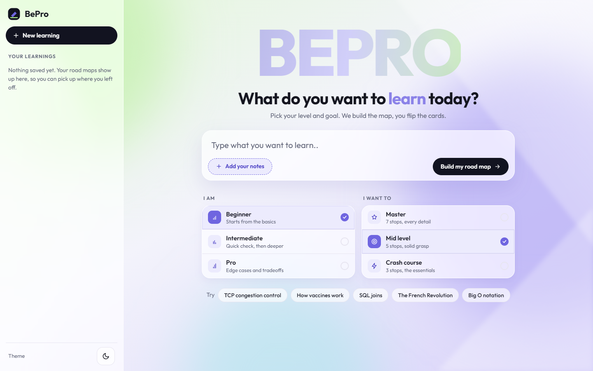
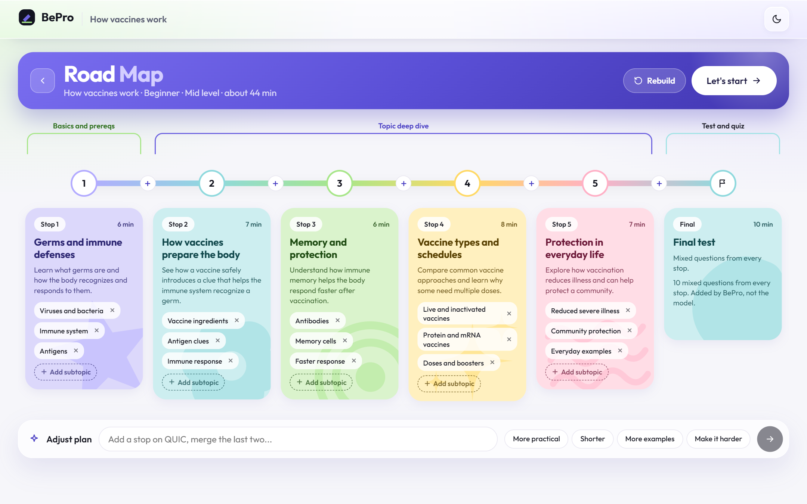
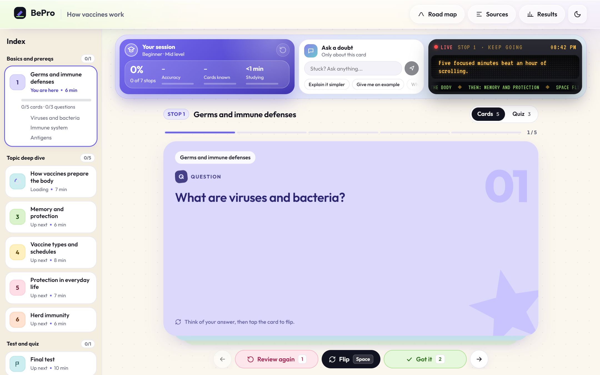
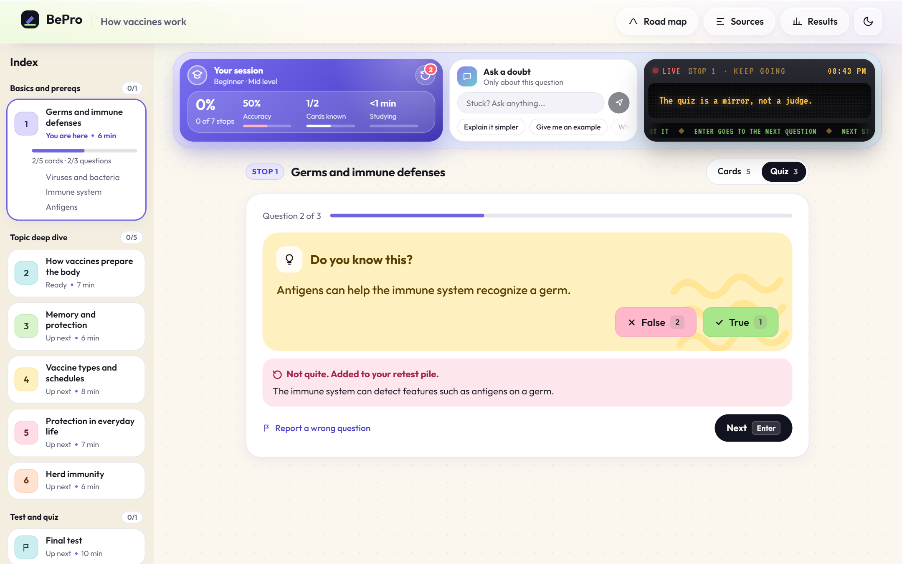
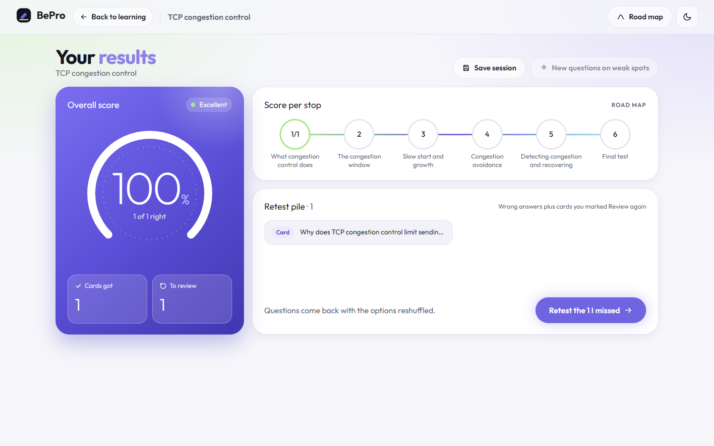

# BePro

An AI study assistant that is **not a chatbot**. Type a topic (or paste your notes), pick your level and goal, and BePro builds an editable **road map** of stops. Each stop is learned flashcard first: a card with a question and a visual, flip for the answer, rate it, then take a short quiz. Wrong answers and cards you mark "Review again" go to a **retest pile**.

The model only fills in content. **Our code decides the structure** (how many stops, cards and questions, how long answers are) and **checks every reply** before it reaches the screen.

| Start | Road map |
| --- | --- |
|  |  |

| Flashcards | Quiz |
| --- | --- |
|  |  |

| Results | Night theme | Phone |
| --- | --- | --- |
|  |  |  |

The content in these screenshots came from a real model, not the mock.

## Setup

Needs Node 18 or newer.

```bash
npm install
npm start                 # app on http://localhost:5173, API on :8787
```

With no `.env`, the server runs on built-in sample content (the mock provider) so you can click through everything right away; the start screen then says "Demo mode". For a real model:

```bash
cp .env.example .env      # then fill in a model, see below, and restart
```

Pick a model backend in `.env`:

| `LLM_PROVIDER` | What it needs | Notes |
| --- | --- | --- |
| `openai` (default) | `LLM_BASE_URL`, `LLM_MODEL`, usually `LLM_API_KEY` | Any OpenAI compatible endpoint: Groq (free tier), OpenRouter, Ollama, OpenAI. Groq example is prefilled. |
| `mock` | nothing | Canned replies, no network. Used automatically when no model is set up. |
| `codex` | a logged in local Codex CLI | What I used during development. |

`npm test` runs 24 tests: bad model output fixtures and the reducer rules.

To watch the failure handling, set `LLM_CHAOS=0.5` in `.env`. Half of the model replies then get broken on purpose (wrapped in prose, truncated, empty, wrong answer index, or 22 seconds slow).

## Usage

1. **Start:** type a topic, choose *I am* (Beginner, Intermediate, Pro) and *I want to* (Master, Mid level, Crash course). "+ Add your notes" switches to notes mode: cards then quote your notes.
2. **Road map:** stops grouped into phases. Click a stop's number to move, rename or delete it; **+** on the road inserts a stop; subtopic chips can be removed or added. **Adjust plan** sends an instruction ("add a stop on QUIC") and the model edits the existing plan instead of starting over. Intermediate learners get a 3 question basics check.
3. **Learn:** click a card or press Space to flip it, rate it (1 = Review again, 2 = Got it), **Read further** opens a longer explanation inside the card. The meter above the deck shows every card of the stop; click a segment to jump. Then the quiz (1 to 4 answers, Enter for next).
   * The **Index** on the left lists every stop with its status; click one to jump there.
   * The **session card** shows how much of the road map is done, your quiz accuracy, cards known, minutes studying, and a Retest button with the size of your retest pile.
   * **Ask a doubt** answers only about the card or question on screen (and never gives away an unanswered question).
   * The **live board** rotates motivation lines and study tips, and warns you after two "Review again" in a row.
   * **Road map** in the top bar opens the map as a card over the page; **Sources** lists the quotes from your notes, or Wikipedia searches for a topic.
4. **Results:** score gauge, score per stop, the retest pile, "Retest the N I missed", and "New questions on weak spots". **Back to learning** returns to your stop.

Sessions save to localStorage and come back on reload. The moon button switches between the Meadow (light) and Night (dark) themes.

**Keyboard:** Space flips the card, 1 = Review again, 2 = Got it, arrow keys move between cards, 1 to 4 pick a quiz answer, Enter goes to the next question.

**Screen sizes:** on a laptop or desktop the start screen and the learning page each fit in one window without page scrolling (a long answer scrolls inside its card). On a phone or tablet the Index becomes a drawer and the card's buttons stick to the bottom. On big monitors (1800px and wider) the whole interface scales up a step.

## How bad model output is handled

Every reply goes through `server/llm/pipeline.js` and `server/llm/checks.js`:

1. **Empty** reply: `EMPTY_OUTPUT`.
2. **Extract:** strip markdown fences, slice from the first `{` to the last `}`.
3. **Parse** with `JSON.parse`.
4. **Shape:** zod checks the outer object (for example, `cards` and `quiz` arrays).
5. **Item by item:** each card and question is checked on its own. A bad one is **dropped with a warning**, the rest survive.
6. **Semantic checks:** `answerIndex` inside the options, no duplicate options, no repeated cards, chart arrays of equal length, diagram edges pointing to real nodes, and in notes mode the quote must really be in your notes (else the card shows "Not found in your notes").
7. **Bad visual:** the visual is dropped and the card stays.
8. **Too little left:** fewer than 60% valid cards (or fewer than 2 questions) counts as a failure.

Any failure in steps 1 to 8 gets **one retry** with the problem appended to the prompt. If that also fails, the UI shows a plain error with **Try again** (and **Skip** for a single stop). Each model call times out after 25 seconds. Errors that a retry can't fix (no model set up, a rejected API key) say what to change instead of offering Try again.

On the client (`src/api/client.js`, `src/state/`):

* The response is **checked again** with the same zod schemas. Never trust the network.
* **Stale guard:** every request gets a `requestId` stored in its slot. A reply whose id isn't the slot's current one is ignored, and the previous request for the same slot is aborted. The doubt bot does the same for its own questions. There's a test for this in `src/state/sessionReducer.test.js`.
* After 20 seconds the UI says "Taking longer than usual" with Try again and Cancel.
* Quiz options are **shuffled** (and `answerIndex` remapped), because models like to put the right answer first.
* An error boundary means a render bug shows a reload screen, never a blank page.

The API key only lives on the server. The browser calls `/api/*`, and Vite proxies it to Express.

## Project layout

```
shared/       zod schemas and the learning profile, used by server AND client
server/       Express API: routes, provider (fetch / codex / mock), prompts, pipeline, checks, tests
src/api       fetch wrapper (timeout, abort, re-validation)
src/state     reducer with the stale guard, derived selectors, localStorage, the useApp hook
src/screens   Start, Roadmap, Learn, Results
src/components flashcard, five visual renderers, quiz question, index, session card, live board, doubt bot...
src/styles    tokens.css (both themes), base.css, then one file per screen or component
```

Where to look first:

| Question | File |
| --- | --- |
| How is a model reply checked? | `server/llm/pipeline.js`, then `server/llm/checks.js` |
| What does valid data look like? | `shared/schemas.js` |
| How are stale replies ignored? | `REQUEST_*` cases in `src/state/sessionReducer.js`, and `run()` in `src/state/useApp.js` |
| How does the browser call the server? | `src/api/client.js` |
| Who decides how many cards and questions? | `shared/profile.js` |

Design decisions and their reasons are in `docs/DECISIONS.md`. The full spec is `SPEC.md`.

## AI usage

I used AI heavily and want to be clear about how:

* **Claude (Claude Code)** wrote most of the code from my spec (`SPEC.md`), which I wrote and iterated on with it. It also produced the design mockups from reference images I collected, and drove a headless browser to screenshot every screen in both themes and at phone width.
* **Codex CLI** was the model behind the app during development (`LLM_PROVIDER=codex`).
* I reviewed the code and steered the design over many rounds of feedback (each round is a row in `docs/DECISIONS.md`): the theme, colored cards, the live board, the Index on the left, the session card, the navigation, and the Night colors.
* A real-model test found a bug the mock couldn't: in notes mode the model left the source quote off quiz questions, so they were flagged "Not found in your notes". The fix was in the prompt (`notesRules` in `server/llm/prompts.js`). ‹OWNER: add what you changed or rewrote yourself.›

## Known limitations

* Visuals are drawn by our own components, so they are simple. The diagram layout is a basic layered layout and can look crowded with 8 nodes.
* Image visuals come from the Wikimedia Commons search API. A vague search term can return an unrelated picture.
* No streaming: each stop's content arrives in one piece. The next stop is prefetched while you study, which hides most of the wait.
* Editing a stop (rename, subtopics) clears its cached cards and their progress, because the old cards may no longer fit.
* Sessions live in this browser's localStorage only. No accounts, no sync.
* Small local models (for example via Ollama) fail the checks more often. The app stays usable but shows more retries.

## Time spent

‹OWNER: fill in›. The schedule was 4 days. I spent the time on the spec, design, build and testing.
